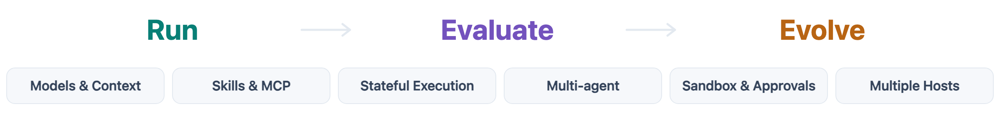
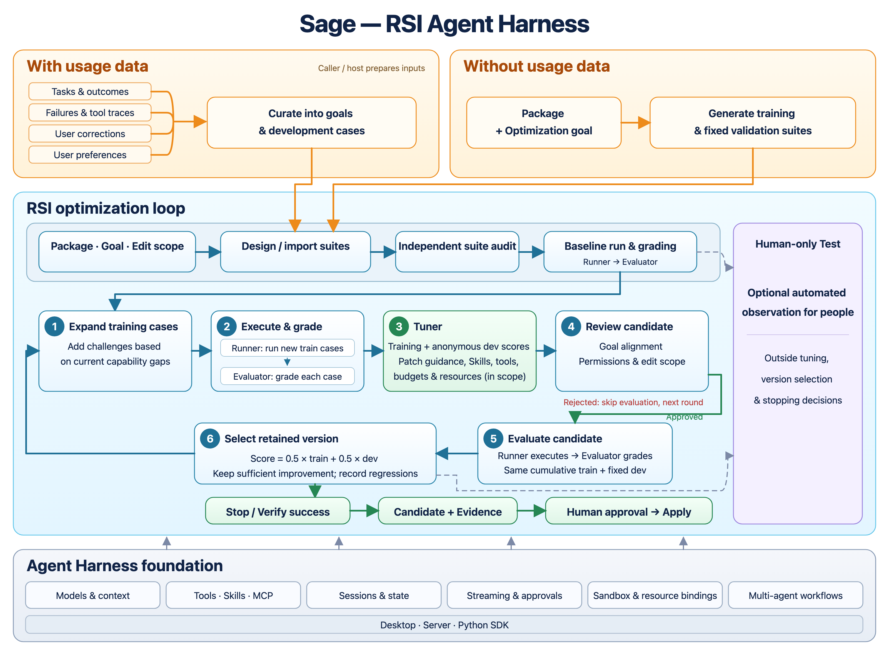
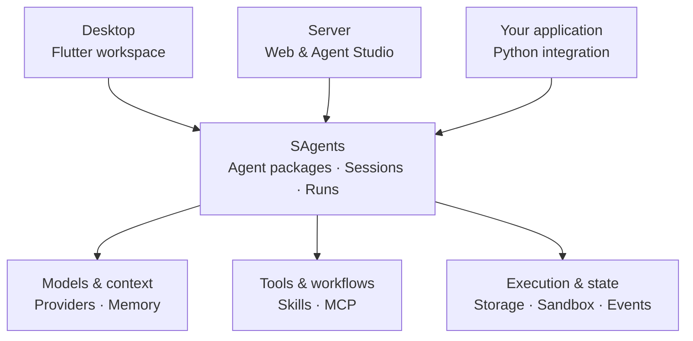

<div align="center">

# **Sage — RSI Agent Harness**


[](README.md)
[](README_CN.md)
[](LICENSE)
[](https://python.org)
[](https://github.com/ZHangZHengEric/Sage)
[](https://deepwiki.com/ZHangZHengEric/Sage)
[](https://join.slack.com/t/sage-b021145/shared_invite/zt-3t8nabs6c-qCEDzNUYtMblPshQTKSWOA)

</div>

**Sage is an RSI Agent Harness** for improving agents through task feedback. RSI (Recursive Self-Improvement) starts from a goal or curated usage history, retains each version and its evidence, and leaves adoption in your hands.

<picture>
  <source media="(prefers-color-scheme: dark)" srcset="assets/features-en-dark.png">
  <source media="(prefers-color-scheme: light)" srcset="assets/features-en-light.png">
  
</picture>

[Try RSI](docs/en/applications/FIRST_RSI_RUN.md) · [Download Desktop](https://github.com/ZHangZHengEric/Sage/releases/tag/v2.1.1) · [Python SDK](sagents/v2/README.md) · [Docs](docs/en/README.md)

## 🔄 How RSI works



[Workflow guide](docs/en/applications/RSI.md) · [Evaluation and selection rules](sagents/v2/optimization/README.md) · [Editable diagram (SVG)](assets/rsi-agent-harness-en.svg)

## 🚀 Get Started

Sage, Desktop, Server, and SAgents refer to the current v2 implementation by default. For the legacy version, use the separate [Sage v1 guide](app/v1/README.md).

| Choose your path | Start here |
| --- | --- |
| 🧬 **First RSI run** — Inspect a scripted loop without an API key | [Offline walkthrough](docs/en/applications/FIRST_RSI_RUN.md) |
| 💻 **Desktop** — Configure agents, run RSI, and choose versions | [Desktop guide](app/v2/desktop/README.md) |
| 🌐 **Server** — Multi-user web access and Agent Studio | [Server guide](app/v2/server/README.md) |
| 🧠 **SAgents** — Build and optimize agents through Python | [Runtime quick start](sagents/v2/README.md#quick-start) |
| 📦 **Desktop installers** — Available release builds | [Downloads & release instructions](https://github.com/ZHangZHengEric/Sage/releases/tag/v2.1.1) |

<details>
<summary>📦 Install Desktop</summary>

1. Download [Sage 2.1.1](https://github.com/ZHangZHengEric/Sage/releases/tag/v2.1.1) for macOS (arm64/x86_64), Windows (x86_64), or Linux (arm64/x86_64).
2. Install and open Sage. Python and the backend are bundled; no repository checkout, system Python, or Flutter is needed. Linux still requires GTK and bubblewrap.
3. Add your model in Settings → Configure an Agent → Start a conversation. Your model service may charge usage fees. See the [Desktop guide](docs/en/applications/DESKTOP.md#first-task).
4. macOS packages are not notarized; Windows installers are not code-signed. See the [release notes](release_notes/v2.1.1.md) for package details.

</details>

<details>
<summary>💻 Run Desktop from source</summary>

Requires **Python 3.12+** and **[Flutter](https://flutter.dev/)** with Dart `^3.12.2` and desktop support. On macOS:

```bash
git clone https://github.com/ZHangZHengEric/Sage.git
cd Sage
python3.12 -m venv .venv
source .venv/bin/activate
python -m pip install -e '.[desktop]'
cd app/v2/desktop
flutter pub get
flutter run -d macos
```

**Add a model → Configure an Agent → Start a conversation or open a project.**

The app starts its local backend automatically. Settings and session data live in `~/sage/runtime`; the default workspace is `~/sage/agent_workspace`.

For Windows and Linux setup, see the [Desktop guide](app/v2/desktop/README.md). Sage 2.1 packages and the release boundary are documented in [v2.1.1 release notes](release_notes/v2.1.1.md). GitHub Actions builds Flutter v2 installers with an embedded Python runtime; the legacy Tauri installers belong to v1.

</details>

<details>
<summary>🌐 Run Server from source</summary>

Requires **Python 3.12+**, **MySQL**, and **Node.js 22.12+**. From the checkout root, with the Python environment active:

```bash
python -m pip install -e '.[server]'
cp .env.example app/v2/server/.env
```

Set the MySQL connection, JWT secret, and initial administrator credentials in `.env`, then run:

```bash
cd app/v2/server/web
npm install
npm run build
cd ../../..
python -m app.v2.server
```

Open **[localhost:8090](http://localhost:8090)**. Add a model and an Agent to start chatting, or open **`/studio`** to manage Agent packages.

See the [Server guide](app/v2/server/README.md) for configuration. Server currently supports **one worker**; MySQL persistence does not enable horizontal scaling.

</details>

<details>
<summary>🐍 Complete Python SDK example</summary>

**One Python file; no `sage.yaml` required.** After the Python setup above, save as `quickstart.py` and replace `your-model` with an available model:

```python
"""Set MODEL_API_KEY and replace your-model below; no sage.yaml file is needed."""

from typing import cast

from sagents.v2.composition.loaded_agents import ApplicationEntrypoint

import asyncio
from uuid import uuid4

from sagents.v2 import ActorRef, RequestContext, SAgentBuilder, StartRun
from sagents.v2.contracts.commands import InputItem
from sagents.v2.contracts.items import TextBlock
from sagents.v2.contracts.principals import PrincipalType
from sagents.v2.package.manifest import SageManifestLoader

AGENT_YAML = """
schema_version: sage/v2
kind: application
metadata: {id: example.assistant, version: 1.0.0, name: Assistant}
agents:
  main:
    name: Assistant
    instructions: {inline: "Be helpful and concise."}
    models: {primary: primary}
entrypoint: {agent: main}
"""

MODELS_YAML = """
credentials:
  api-key: {source: env, key: MODEL_API_KEY}
models:
  primary:
    provider: openai-responses
    base_url: https://api.openai.com/v1
    credential: api-key
    model: your-model
"""


async def main(*, runtime=None, registrations=()):
    from sagents.v2.composition.defaults import default_runtime
    manifest = SageManifestLoader().loads(AGENT_YAML)
    builder = SAgentBuilder()
    for registration in registrations:
        builder.register(registration)
    app = await builder.build(runtime=runtime or default_runtime("runtime"), models_config_text=MODELS_YAML)
    try:
        agent = await app.load_agent(manifest)
        context = RequestContext(actor=ActorRef(
            principal_id="user-1", principal_type=PrincipalType.USER,
        ))
        stream = await cast(ApplicationEntrypoint, app.entrypoint()).run_stream(StartRun(
            agent_id=agent.id,
            input=(InputItem(role="user", content=(TextBlock(text="Say hello!"),)),),
            resolved_spec_hash=agent.composition_hash,
            idempotency_key=str(uuid4()),
        ), context, agent=agent)
        async for event in stream.events:
            print(event.model_dump_json())
        print((await stream.wait()).state)
    finally:
        await app.close()


if __name__ == "__main__":
    asyncio.run(main())
```

```bash
export MODEL_API_KEY="your-api-key"
python quickstart.py
```

`loads()` parses YAML text; `build()` accepts the manifest object directly. This prints events and the final state, without file or shell tools. [More configuration options →](docs/en/applications/GETTING_STARTED.md)

</details>

## 🛠️ Harness capabilities

| Capability | What you can do |
| --- | --- |
| 📦 **Packages and versions** | Define instructions, Skills, tools, and resources in `sage.yaml`; retain candidates, diffs, and evaluation records. |
| 🧠 **Models and context** | Connect model providers and configure routes, memory, and context budgets. |
| 🔌 **Tools, Skills, and MCP** | Compose native tools, reusable Skills, and MCP services with host-managed authorization. |
| 💾 **Stateful execution** | Persist Sessions, stream output, and pause/resume for human input and approvals. |
| 🛡️ **Sandbox and resources** | Bind execution resources, sandbox providers, tool policies, and runtime budgets through the host. |
| 🤝 **Multi-agent workflows and extensions** | Orchestrate workflows and member messages; replace model, memory, storage, tool, and scheduling providers. |
| 🪟 **Native interactive UI** | Stream light/dark Glass interfaces, charts, inputs, and slides, with local calculations and editable PPTX export. [Explore OpenUI](app/v2/desktop/README.md#openui). |
| 🖥️ **Multiple hosts** | Use Desktop, Server/Studio, or embed SAgents in your Python application. |

<details>
<summary>📐 Support and runtime boundaries</summary>

- Desktop RSI currently supports simple types and native tools; general MCP integration does not imply support in RSI bindings.
- Built-in configurations target one process or host; Server supports one worker. Local execution is not container isolation.
- Callers curate history into goals or suites. The default workflow uses fixed dev and expanding train; dev guides development and independent test measurements are observation-only.
- RSI produces candidates without activating them. Persistent state does not provide distributed job takeover or automatic checkpoint resume.

[RSI support boundaries](docs/en/applications/RSI.md) · [Runtime architecture](sagents/v2/ARCHITECTURE.md)

</details>

<details>
<summary>📊 Experiment snapshot</summary>

τ²-bench v1.0.1 retail with gpt-5.6-luna as the target model. The baseline and frozen RSI candidate each completed 40 test tasks with four trials per task, for 320 measurements.

| Metric | Baseline | After RSI | Gain |
| --- | ---: | ---: | ---: |
| Task success pass¹ | 75.000% | 83.125% | +8.125 percentage points |
| All-four success pass⁴ | 57.50% | 65.00% | +7.50 percentage points |

gpt-6.1-sol served as tuner, user simulator, and natural-language judge. Train/dev selected the candidate; test did not influence selection. Results retain 28 paired improvements and 15 regressions. This exploratory local measurement is not an official leaderboard result.

[Experiment protocol](docs/en/applications/TAU_BENCH.md) · [Per-trial measurements and statistics](docs/assets/benchmarks/tau-retail-rsi.json)

</details>

<details>
<summary>🧠 SAgents runtime architecture</summary>



- 📦 **Agent package** — Define what an agent can do.
- 💬 **Session** — Keep its conversation history across Runs.
- ⚡ **Run** — Execute a task with live progress and interaction.

Your application owns the UI, authentication, and credentials. Built-in runtime configurations target a single process or host; local process execution is not container isolation.

[Explore the runtime →](sagents/v2/README.md) · [Read the architecture →](sagents/v2/ARCHITECTURE.md)

</details>

<details>
<summary>📰 Latest updates</summary>

- **2026-10-13** — [Streaming UI: from an answer to a native interactive interface](docs/en/applications/STREAMING_UI.md) — Live generation, local calculations, Process Panel revisions, and editable PPTX export in Desktop 2.1.
- **2026-10-12** — [MCP tools are visible, but calls fail: a five-step diagnostic](knowledge/tutorials/mcp-visible-calls-fail.md)
- **2026-10-12** — RSI: multi-round Agent package optimization, suite audits, semantic review, Desktop progress, and Agent-level version history. See the workflow guide for the current evaluation protocol. [Python API](sagents/v2/optimization/README.md) · [Desktop guide](app/v2/desktop/README.md#rsi-与-agent-版本)
- **2026-10-11** — [OpenRouter free models: selection and limits](knowledge/resources/openrouter-free-models.md)
- **2026-10-11** — [MCP engineering resources: protocols, SDKs, testing, and security](knowledge/resources/mcp-engineering-resources.md)
- **2026-10-11** — [A read-only MCP smoke test through Sage](knowledge/tutorials/mcp-smoke-test.md)

[More agent resources and tutorials →](knowledge/README.md)

</details>

## 📚 **Documentation**

| Learn | Build |
| --- | --- |
| [Documentation index](docs/en/README.md) | [Runtime integration manual](sagents/v2/使用手册.md) |
| [Desktop](app/v2/desktop/README.md) | [Server Agent platform](docs/zh/architecture/SERVER_V2_AGENT_PLATFORM.md) |
| [Server](app/v2/server/README.md) | [Deployment](deploy/README.md) |
| [Versioned source layout](docs/VERSIONED_LAYOUT.md) | v1 directories and import migration |
| [Release notes](release_notes/) | [Development changelog](change_log.md) |

[Model inference provider resources](knowledge/resources/model-inference-providers.md)

Some component guides are currently in Chinese. Use the guide for your chosen entry point.

## 🛠️ **Contributing**

**Your first PR is welcome!** Documentation, translations, examples, tests, bug fixes, and model/tool integrations all help Sage grow. We welcome small, focused improvements and are happy to work with you to get useful, well-tested contributions merged.

Start with the [contribution guide](CONTRIBUTING.md) for setup, component checks, and a PR checklist. Browse [open issues](https://github.com/ZHangZHengEric/Sage/issues), or open an issue to discuss a larger change before building it. A small documentation fix can go straight to a PR.

Explore [`sagents/v2/`](sagents/v2/) for the runtime, [`app/v2/desktop/`](app/v2/desktop/) for the desktop app, and [`app/v2/server/`](app/v2/server/) for the web platform.

## 💬 **Community**

<div align="center">

[](https://join.slack.com/t/sage-b021145/shared_invite/zt-3t8nabs6c-qCEDzNUYtMblPshQTKSWOA)
[](https://github.com/ZHangZHengEric/Sage/issues)

</div>

## 💖 **Sponsors**

<p align="center">
  <a href="https://movoai.pro/"></a>
  &nbsp;&nbsp;&nbsp;&nbsp;&nbsp;&nbsp;
  
  &nbsp;&nbsp;&nbsp;&nbsp;&nbsp;&nbsp;
  
</p>

---

<div align="center">

[MIT License](LICENSE) · Built with ❤️ by the Sage Team 🦌

</div>
