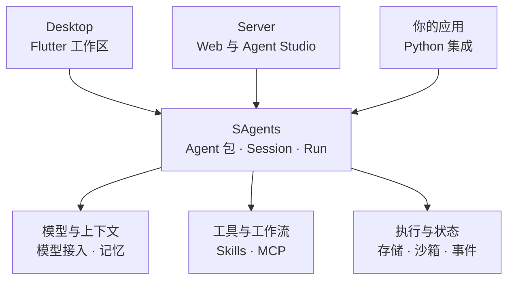

<div align="center">

# 🌟 **体验 Sage 的强大能力**


[](README.md)
[](README_CN.md)
[](LICENSE)
[](https://python.org)
[](https://github.com/ZHangZHengEric/Sage)
[](https://deepwiki.com/ZHangZHengEric/Sage)
[](https://join.slack.com/t/sage-b021145/shared_invite/zt-3t8nabs6c-qCEDzNUYtMblPshQTKSWOA)

# 🧠 **Sage · 自定义、自进化智能体**

### 🎯 **定义智能体，评测能力，迭代进化**

> 🌟 **构建自定义、自进化智能体的开源平台。定义 Agent package，通过 RSI 多轮评测与调优持续迭代，保留完整版本历史，由你选择采用哪个版本。**

</div>

首次阅读代码？从 [代码阅读指南](docs/zh/architecture/code-reading-guide.md) 开始，按运行链路定位 sagents、desktop、server 和相关测试。

基于 sagents 开发新项目：[统一开发入口、配置与调试规范](docs/zh/architecture/sagents-host-development.md)，附可离线运行的参考项目。

---

## ✨ **核心优势**

- 📦 **自定义 Agent 包** — 用 `sage.yaml` 定义指令、Skills、工具与运行配置，在 Desktop、Server 或自己的 Python 应用中复用。
- 🧬 **RSI 自进化** — 通过独立 Session 的评测、调优和审查 Agent，按设定轮数测试与改进 package；保留每轮完整记录，由用户选择版本。
- 🧩 **插件化架构** — 按需组合模型、记忆、存储、工具和调度实现，统一管理扩展契约与组件生命周期。
- 🪟 **原生流式界面（Desktop 2.1）** — 使用 [OpenUI](https://github.com/thesysdev/openui) 官方解析器，将 Assistant 的 `openui` 代码块随输出增量渲染为 Flutter Glass 界面，支持深浅色和 31 类原生组件，含图表、指标、标签页、流程图、丰富输入及即时本地计算。纯本地交互不需要提交按钮或再次请求模型；提交按钮仅用于明确将参数交回助手。用户自然提问即可，无需提 OpenUI；可在加号菜单开启“优先交互 UI”，或在“设置 → 通用 → 默认开启交互式 UI”设置新聊天的默认值。开启后宿主自动预加载完整 Skill，无需工具调用。演示文稿支持原生 16:9 流式预览，并从同一份数据导出可编辑 PPTX。当前支持指定组件子集，使用 Sage 自己的原生渲染器；2.1.1 桌面安装包包含这些功能。[接入说明](app/v2/desktop/README.md#openui)。
- 🔄 **有状态、可交互的执行** — 持久化 Session 历史，流式输出事件，支持暂停、恢复、人工输入与审批。
- 🤝 **多智能体编排** — 通过定向消息协调 Studio 成员，或在运行时中组合 Agent Flow。
- 🔌 **可扩展的工具生态** — 将内置工具、可复用 Skills 与 [MCP](https://modelcontextprotocol.io/) 服务接入同一智能体工作流程。
- 🏗️ **统一内核，多端接入** — 通过 Desktop 和 Server 使用 SAgents，也可以嵌入自己的 Python 应用。

---

## 🧬 **RSI：从自定义到自进化**

输入 Agent package，设置优化目标、轮数和允许修改的范围，就可以启动独立的 RSI（Recursive Self-Improvement）循环。

- **按需调优** — 可只优化 Skills，或开放指令指导、工具启用列表与步数预算。支持用户提供测试集，也可由测试设计 Agent 生成，支持单轮任务与设有轮数上限的多轮对话。
- **独立评测与审查** — 运行目标 Agent 前，独立 Session 的审查 Agent 先检查测试集与授权目标的一致性。评测和候选语义审查分别检查任务完成、背题和目标漂移；独立最终测试集在基线前封存。
- **每次迭代可追溯** — 保留原始版本、每轮完整 package、测试回答、评测及审查结果。Desktop 显示后台进度和 RSI 运行历史。Agent 配置层级单独保存人工编辑与确认应用的版本，未应用的候选保留在对应 RSI 记录中。
- **用户决定采用版本** — 优化不会直接替换原配置。用户查看对比结果、选择版本并确认后，Desktop 才应用该版本；没有更好的候选时保留原版本。

参见 [RSI 流程指南](docs/zh/applications/RSI.md)。从 [Python API](sagents/v2/optimization/README.md) 使用 `AgentPackageOptimizer`，或在 [Desktop 的 Agent 配置](app/v2/desktop/README.md#rsi-与-agent-版本)中打开 RSI。当前 Desktop RSI 支持 simple Agent 与原生工具，安装包支持范围以对应版本说明为准。

---

## 📰 **最新动态**

- **2026-10-13** — [Streaming UI：让回答直接成为原生交互界面](docs/zh/applications/STREAMING_UI.md) — 了解 Desktop 2.1 的流式生成、本地计算、过程稿收纳和可编辑 PPTX 导出。

---

## 🚀 **快速开始**

Sage、Desktop、Server 和 SAgents 默认指当前 v2 实现。旧版单独见 [Sage v1 指南](app/v1/README.md)。

| 选择你的入口 | 从这里开始 |
| --- | --- |
| 💻 **Desktop** — 配置智能体、运行 RSI、选择版本 | [桌面端指南](app/v2/desktop/README.md) |
| 🌐 **Server** — 多用户 Web 应用与 Agent Studio | [服务端指南](app/v2/server/README.md) |
| 🧠 **SAgents** — 通过 Python 构建与调优智能体 | [运行时快速开始](sagents/v2/README.md#quick-start) |
| 📦 **桌面安装包** — 已发布版本 | [下载与版本说明](https://github.com/ZHangZHengEric/Sage/releases/tag/v2.1.1) |

### 📦 安装桌面端

1. 下载 [Sage 2.1.1](https://github.com/ZHangZHengEric/Sage/releases/tag/v2.1.1)：支持 macOS（arm64/x86_64）、Windows（x86_64）和 Linux（arm64/x86_64）。
2. 安装并打开 Sage。安装包已包含 Python 和后端，无需克隆仓库、安装系统 Python 或 Flutter；Linux 仍需 GTK 和 bubblewrap。
3. 在设置中添加模型 → 配置 Agent → 开始对话。模型服务可能收取使用费用，操作步骤见[桌面端指南](docs/zh/applications/DESKTOP.md#第一个任务)。
4. macOS 安装包未公证，Windows 安装包未做代码签名；各类安装包详情见 [版本说明](release_notes/v2.1.1.md)。

### 💻 从源码启动桌面端

需要 **Python 3.12+**，以及支持桌面构建、Dart 版本满足 `^3.12.2` 的 **[Flutter](https://flutter.dev/)**。macOS 下运行：

```bash
git clone https://github.com/ZHangZHengEric/Sage.git
cd Sage
python3.12 -m venv .venv
source .venv/bin/activate
python -m pip install -e '.[desktop]'
cd app/v2/desktop
flutter pub get
flutter run -d macos
```

**添加模型 → 配置 Agent → 开始对话或打开项目。**

应用自动启动本机后端。设置与会话数据保存在 `~/sage/runtime`，默认工作区为 `~/sage/agent_workspace`。

Windows、Linux 配置见 [桌面端指南](app/v2/desktop/README.md)。2.1 发布包与版本边界见 [v2.1.1 版本说明](release_notes/v2.1.1.md)。GitHub Actions 构建包含 Python 运行环境的 Flutter v2 安装包；旧 Tauri 安装包属于 v1。

### 🌐 从源码启动服务端

需要 **Python 3.12+**、**MySQL** 和 **Node.js 22.12+**。在仓库根目录、已激活 Python 环境的终端中执行：

```bash
python -m pip install -e '.[server]'
cp app/v2/server/.env.example app/v2/server/.env
```

在 `.env` 中配置 MySQL 连接、JWT 密钥和初始管理员账号，然后运行：

```bash
cd app/v2/server/web
npm install
npm run build
cd ../../..
python -m app.v2.server
```

打开 **[localhost:8090](http://localhost:8090)**，添加模型和 Agent 后开始对话；进入 **`/studio`** 管理 Agent 包。

详细配置见 [服务端指南](app/v2/server/README.md)。Server 当前支持**单 worker**，MySQL 持久化不代表已支持横向扩容。

### 🧑‍💻 用 SAgents 运行第一个 Agent

**一个 Python 文件即可，无需创建 `sage.yaml`。** 完成上面的 Python 安装后，保存为 `quickstart.py`，将 `your-model` 替换为可用模型：

```python
"""Set MODEL_API_KEY and replace your-model below; no sage.yaml file is needed."""

import asyncio
from uuid import uuid4

from sagents.v2 import ActorRef, RequestContext, SAgentBuilder, StartRun
from sagents.v2.contracts.commands import InputItem
from sagents.v2.contracts.items import TextBlock
from sagents.v2.contracts.principals import PrincipalType
from sagents.v2.package.manifest import SageManifestLoader

AGENT_YAML = """
schema_version: sage/v2
kind: application
metadata: {id: example.assistant, version: 1.0.0, name: Assistant}
agents:
  main:
    name: Assistant
    instructions: {inline: "Be helpful and concise."}
    models: {primary: primary}
entrypoint: {agent: main}
"""

MODELS_YAML = """
credentials:
  api-key: {source: env, key: MODEL_API_KEY}
models:
  primary:
    provider: openai-responses
    base_url: https://api.openai.com/v1
    credential: api-key
    model: your-model
"""


async def main(*, runtime=None, registrations=()):
    from sagents.v2.composition.defaults import default_runtime
    manifest = SageManifestLoader().loads(AGENT_YAML)
    builder = SAgentBuilder()
    for registration in registrations:
        builder.register(registration)
    app = await builder.build(runtime=runtime or default_runtime("runtime"), models_config_text=MODELS_YAML)
    try:
        agent = await app.load_agent(manifest)
        context = RequestContext(actor=ActorRef(
            principal_id="user-1", principal_type=PrincipalType.USER,
        ))
        stream = await app.entrypoint().run_stream(StartRun(
            agent_id=agent.id,
            input=(InputItem(role="user", content=(TextBlock(text="Say hello!"),)),),
            resolved_spec_hash=agent.composition_hash,
            idempotency_key=str(uuid4()),
        ), context, agent=agent)
        async for event in stream.events:
            print(event.model_dump_json())
        print((await stream.wait()).state)
    finally:
        await app.close()


if __name__ == "__main__":
    asyncio.run(main())
```

```bash
export MODEL_API_KEY="your-api-key"
python quickstart.py
```

`loads()` 解析 YAML 字符串，`build()` 直接接收 manifest 对象。示例输出事件和最终状态，不启用文件或 Shell 工具。[更多配置方式 →](docs/zh/applications/GETTING_STARTED.md)

---

## 🧠 **SAgents 内核**



- 📦 **Agent 包** — 定义智能体可以做什么。
- 💬 **Session** — 保存跨 Run 的对话历史。
- ⚡ **Run** — 执行任务，提供实时进度与交互。

宿主应用负责界面、身份认证和凭据。内置运行配置面向单进程或单宿主；本机进程执行不提供容器级隔离。

[了解运行时 →](sagents/v2/README.md) · [阅读架构设计 →](sagents/v2/ARCHITECTURE.md)

---

## 📚 **文档导航**

| 了解 Sage | 构建与扩展 |
| --- | --- |
| [文档索引](docs/zh/README.md) | [运行时集成手册](sagents/v2/使用手册.md) |
| [Desktop](app/v2/desktop/README.md) | [Server Agent 平台](docs/zh/architecture/SERVER_V2_AGENT_PLATFORM.md) |
| [Server](app/v2/server/README.md) | [部署指南](deploy/README.md) |
| [版本目录说明](docs/VERSIONED_LAYOUT.md) | v1 代码位置与导入迁移 |
| [版本说明](release_notes/) | [开发变更日志](change_log.md) |

请优先阅读所选入口对应的组件文档。

## 🛠️ **参与贡献**

**欢迎提交你的第一个 PR！** 文档、翻译、示例、测试、Bug 修复，以及模型和工具集成，都是对 Sage 的帮助。我们欢迎小而专注的改进，也很乐意与你一起完善贡献，让有价值、经过验证的改动顺利合并。

请从[贡献指南](CONTRIBUTING.md)开始，了解开发配置、组件检查和 PR 清单。可以查看[现有 Issue](https://github.com/ZHangZHengEric/Sage/issues)，较大的改动请先开 Issue 讨论；小的文档修正可以直接提交 PR。

运行时位于 [`sagents/v2/`](sagents/v2/)，桌面端位于 [`app/v2/desktop/`](app/v2/desktop/)，Web 平台位于 [`app/v2/server/`](app/v2/server/)。

## 💬 **加入社区**

<div align="center">

[](https://join.slack.com/t/sage-b021145/shared_invite/zt-3t8nabs6c-qCEDzNUYtMblPshQTKSWOA)
[](https://github.com/ZHangZHengEric/Sage/issues)

</div>

## 💖 **赞助商**

<p align="center">
  
  &nbsp;&nbsp;&nbsp;&nbsp;&nbsp;&nbsp;
  
</p>

---

<div align="center">

[MIT 许可证](LICENSE) · Built with ❤️ by the Sage Team 🦌

</div>
