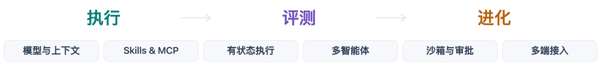
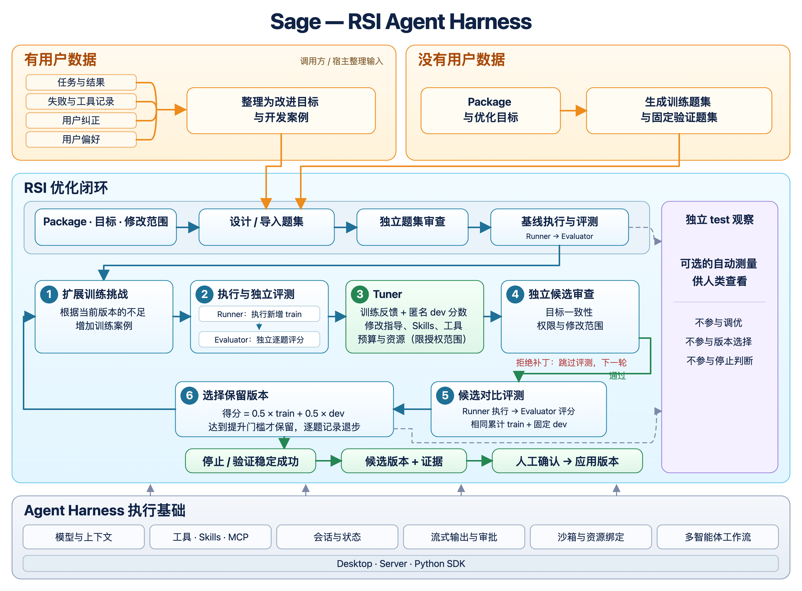
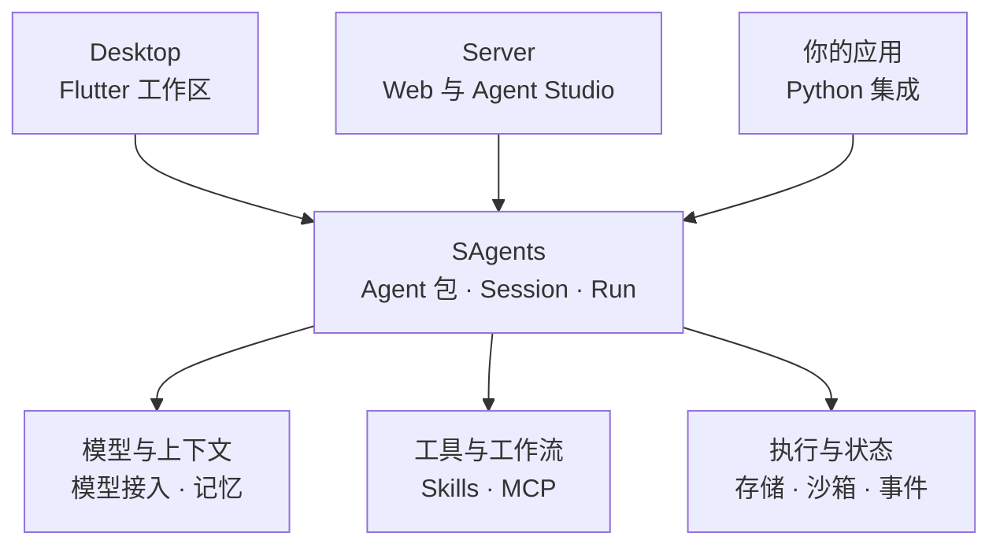

<div align="center">

# **Sage — RSI Agent Harness**


[](README.md)
[](README_CN.md)
[](LICENSE)
[](https://python.org)
[](https://github.com/ZHangZHengEric/Sage)
[](https://deepwiki.com/ZHangZHengEric/Sage)
[](https://join.slack.com/t/sage-b021145/shared_invite/zt-3t8nabs6c-qCEDzNUYtMblPshQTKSWOA)

</div>

**Sage 是一个 RSI Agent Harness**，让智能体从任务反馈中持续改进。RSI（Recursive Self-Improvement，递归自我改进）从目标或整理后的使用历史出发，保留每轮版本与证据，由你决定采用什么。

<picture>
  <source media="(prefers-color-scheme: dark)" srcset="assets/features-zh-dark.png">
  <source media="(prefers-color-scheme: light)" srcset="assets/features-zh-light.png">
  
</picture>

[体验 RSI](docs/zh/applications/FIRST_RSI_RUN.md) · [下载 Desktop](https://github.com/ZHangZHengEric/Sage/releases/tag/v2.1.1) · [Python SDK](sagents/v2/README.md) · [文档](docs/zh/README.md)

## 🔄 RSI 如何迭代



[流程指南](docs/zh/applications/RSI.md) · [评测与版本选择规则](sagents/v2/optimization/README.md) · [可编辑原理图（SVG）](assets/rsi-agent-harness-zh.svg)

## 🚀 快速开始

Sage、Desktop、Server 和 SAgents 默认指当前 v2 实现。旧版单独见 [Sage v1 指南](app/v1/README.md)。

| 选择你的入口 | 从这里开始 |
| --- | --- |
| 🧬 **首次 RSI** — 无需 API Key 查看脚本闭环 | [离线流程演示](docs/zh/applications/FIRST_RSI_RUN.md) |
| 💻 **Desktop** — 配置智能体、运行 RSI、选择版本 | [桌面端指南](app/v2/desktop/README.md) |
| 🌐 **Server** — 多用户 Web 应用与 Agent Studio | [服务端指南](app/v2/server/README.md) |
| 🧠 **SAgents** — 通过 Python 构建与调优智能体 | [运行时快速开始](sagents/v2/README.md#quick-start) |
| 📦 **桌面安装包** — 已发布版本 | [下载与版本说明](https://github.com/ZHangZHengEric/Sage/releases/tag/v2.1.1) |

<details>
<summary>📦 安装 Desktop</summary>

1. 下载 [Sage 2.1.1](https://github.com/ZHangZHengEric/Sage/releases/tag/v2.1.1)：支持 macOS（arm64/x86_64）、Windows（x86_64）和 Linux（arm64/x86_64）。
2. 安装并打开 Sage。安装包已包含 Python 和后端，无需克隆仓库、安装系统 Python 或 Flutter；Linux 仍需 GTK 和 bubblewrap。
3. 在设置中添加模型 → 配置 Agent → 开始对话。模型服务可能收取使用费用，操作步骤见[桌面端指南](docs/zh/applications/DESKTOP.md#第一个任务)。
4. macOS 安装包未公证，Windows 安装包未做代码签名；各类安装包详情见 [版本说明](release_notes/v2.1.1.md)。

</details>

<details>
<summary>💻 从源码启动 Desktop</summary>

需要 **Python 3.12+**，以及支持桌面构建、Dart 版本满足 `^3.12.2` 的 **[Flutter](https://flutter.dev/)**。macOS 下运行：

```bash
git clone https://github.com/ZHangZHengEric/Sage.git
cd Sage
python3.12 -m venv .venv
source .venv/bin/activate
python -m pip install -e '.[desktop]'
cd app/v2/desktop
flutter pub get
flutter run -d macos
```

**添加模型 → 配置 Agent → 开始对话或打开项目。**

应用自动启动本机后端。设置与会话数据保存在 `~/sage/runtime`，默认工作区为 `~/sage/agent_workspace`。

Windows、Linux 配置见 [桌面端指南](app/v2/desktop/README.md)。2.1 发布包与版本边界见 [v2.1.1 版本说明](release_notes/v2.1.1.md)。GitHub Actions 构建包含 Python 运行环境的 Flutter v2 安装包；旧 Tauri 安装包属于 v1。

</details>

<details>
<summary>🌐 从源码启动 Server</summary>

需要 **Python 3.12+**、**MySQL** 和 **Node.js 22.12+**。在仓库根目录、已激活 Python 环境的终端中执行：

```bash
python -m pip install -e '.[server]'
cp .env.example app/v2/server/.env
```

在 `.env` 中配置 MySQL 连接、JWT 密钥和初始管理员账号，然后运行：

```bash
cd app/v2/server/web
npm install
npm run build
cd ../../..
python -m app.v2.server
```

打开 **[localhost:8090](http://localhost:8090)**，添加模型和 Agent 后开始对话；进入 **`/studio`** 管理 Agent 包。

详细配置见 [服务端指南](app/v2/server/README.md)。Server 当前支持**单 worker**，MySQL 持久化不代表已支持横向扩容。

</details>

<details>
<summary>🐍 Python SDK 完整示例</summary>

**一个 Python 文件即可，无需创建 `sage.yaml`。** 完成上面的 Python 安装后，保存为 `quickstart.py`，将 `your-model` 替换为可用模型：

```python
"""Set MODEL_API_KEY and replace your-model below; no sage.yaml file is needed."""

from typing import cast

from sagents.v2.composition.loaded_agents import ApplicationEntrypoint

import asyncio
from uuid import uuid4

from sagents.v2 import ActorRef, RequestContext, SAgentBuilder, StartRun
from sagents.v2.contracts.commands import InputItem
from sagents.v2.contracts.items import TextBlock
from sagents.v2.contracts.principals import PrincipalType
from sagents.v2.package.manifest import SageManifestLoader

AGENT_YAML = """
schema_version: sage/v2
kind: application
metadata: {id: example.assistant, version: 1.0.0, name: Assistant}
agents:
  main:
    name: Assistant
    instructions: {inline: "Be helpful and concise."}
    models: {primary: primary}
entrypoint: {agent: main}
"""

MODELS_YAML = """
credentials:
  api-key: {source: env, key: MODEL_API_KEY}
models:
  primary:
    provider: openai-responses
    base_url: https://api.openai.com/v1
    credential: api-key
    model: your-model
"""


async def main(*, runtime=None, registrations=()):
    from sagents.v2.composition.defaults import default_runtime
    manifest = SageManifestLoader().loads(AGENT_YAML)
    builder = SAgentBuilder()
    for registration in registrations:
        builder.register(registration)
    app = await builder.build(runtime=runtime or default_runtime("runtime"), models_config_text=MODELS_YAML)
    try:
        agent = await app.load_agent(manifest)
        context = RequestContext(actor=ActorRef(
            principal_id="user-1", principal_type=PrincipalType.USER,
        ))
        stream = await cast(ApplicationEntrypoint, app.entrypoint()).run_stream(StartRun(
            agent_id=agent.id,
            input=(InputItem(role="user", content=(TextBlock(text="Say hello!"),)),),
            resolved_spec_hash=agent.composition_hash,
            idempotency_key=str(uuid4()),
        ), context, agent=agent)
        async for event in stream.events:
            print(event.model_dump_json())
        print((await stream.wait()).state)
    finally:
        await app.close()


if __name__ == "__main__":
    asyncio.run(main())
```

```bash
export MODEL_API_KEY="your-api-key"
python quickstart.py
```

`loads()` 解析 YAML 字符串，`build()` 直接接收 manifest 对象。示例输出事件和最终状态，不启用文件或 Shell 工具。[更多配置方式 →](docs/zh/applications/GETTING_STARTED.md)

</details>

## 🛠️ Harness 能力

| 能力 | 可以做什么 |
| --- | --- |
| 📦 **Package 与版本** | 用 `sage.yaml` 定义指令、Skills、工具与资源，保存每轮候选、差异和评测记录。 |
| 🧠 **模型与上下文** | 接入不同模型，配置路由、记忆和上下文预算。 |
| 🔌 **工具、Skills 与 MCP** | 组合原生工具、可复用 Skills 和 MCP 服务，由宿主管理授权。 |
| 💾 **有状态执行** | 持久化会话、流式输出，支持人工输入、审批与暂停恢复。 |
| 🛡️ **沙箱与资源** | 按宿主绑定执行资源、沙箱、工具策略与运行预算。 |
| 🤝 **多智能体与扩展** | 编排工作流和成员消息，替换模型、记忆、存储、工具与调度 provider。 |
| 🪟 **原生交互 UI** | 流式生成深浅色 Glass 界面、图表、输入与幻灯片，支持本地计算和可编辑 PPTX 导出。[了解 OpenUI](app/v2/desktop/README.md#openui)。 |
| 🖥️ **多端接入** | 使用 Desktop、Server/Studio，或将 SAgents 嵌入自己的 Python 应用。 |

<details>
<summary>📐 支持范围与运行边界</summary>

- Desktop RSI 当前支持 simple 类型与原生工具，通用 MCP 接入不代表 RSI 已支持对应绑定。
- 内置运行配置面向单进程或单宿主，Server 支持单 worker；本机执行不等于容器隔离。
- 使用历史由调用方整理成目标或题集；默认流程使用固定 dev 与扩展 train，dev 参与开发，独立 test 仅供观察。
- RSI 生成候选，不自动应用；持久化状态不代表分布式任务接管或自动断点恢复。

[RSI 支持范围](docs/zh/applications/RSI.md) · [运行时架构](sagents/v2/ARCHITECTURE.md)

</details>

<details>
<summary>📊 实验展示</summary>

τ²-bench v1.0.1 retail，目标模型 gpt-5.6-luna。默认版本与冻结后的 RSI 候选各完成 40 个 test 任务、每题四次测量，共 320 次。

| 指标 | 默认版本 | RSI 后 | 提升 |
| --- | ---: | ---: | ---: |
| 任务成功率 pass¹ | 75.000% | 83.125% | +8.125 个百分点 |
| 四次全成功率 pass⁴ | 57.50% | 65.00% | +7.50 个百分点 |

Tuner、用户模拟与自然语言判分使用 gpt-6.1-sol。候选由 train/dev 选定，test 不参与选版；28 次失败变成功，15 次成功变失败，均计入结果。本地探索性测量不代表官方榜单成绩。

[实验说明](docs/zh/applications/TAU_BENCH.md) · [逐次测量与统计证据](docs/assets/benchmarks/tau-retail-rsi.json)

</details>

<details>
<summary>🧠 SAgents 运行时架构</summary>



- 📦 **Agent 包** — 定义智能体可以做什么。
- 💬 **Session** — 保存跨 Run 的对话历史。
- ⚡ **Run** — 执行任务，提供实时进度与交互。

宿主应用负责界面、身份认证和凭据。内置运行配置面向单进程或单宿主；本机进程执行不提供容器级隔离。

[了解运行时 →](sagents/v2/README.md) · [阅读架构设计 →](sagents/v2/ARCHITECTURE.md)

</details>

<details>
<summary>📰 最新动态</summary>

- **2026-10-13** — [Streaming UI：让回答直接成为原生交互界面](docs/zh/applications/STREAMING_UI.md) — 了解 Desktop 2.1 的流式生成、本地计算、过程稿收纳和可编辑 PPTX 导出。

</details>

## 📚 **文档导航**

| 了解 Sage | 构建与扩展 |
| --- | --- |
| [文档索引](docs/zh/README.md) | [运行时集成手册](sagents/v2/使用手册.md) |
| [Desktop](app/v2/desktop/README.md) | [Server Agent 平台](docs/zh/architecture/SERVER_V2_AGENT_PLATFORM.md) |
| [Server](app/v2/server/README.md) | [部署指南](deploy/README.md) |
| [版本目录说明](docs/VERSIONED_LAYOUT.md) | v1 代码位置与导入迁移 |
| [版本说明](release_notes/) | [开发变更日志](change_log.md) |

请优先阅读所选入口对应的组件文档。

## 🛠️ **参与贡献**

**欢迎提交你的第一个 PR！** 文档、翻译、示例、测试、Bug 修复，以及模型和工具集成，都是对 Sage 的帮助。我们欢迎小而专注的改进，也很乐意与你一起完善贡献，让有价值、经过验证的改动顺利合并。

请从[贡献指南](CONTRIBUTING.md)开始，了解开发配置、组件检查和 PR 清单。可以查看[现有 Issue](https://github.com/ZHangZHengEric/Sage/issues)，较大的改动请先开 Issue 讨论；小的文档修正可以直接提交 PR。

运行时位于 [`sagents/v2/`](sagents/v2/)，桌面端位于 [`app/v2/desktop/`](app/v2/desktop/)，Web 平台位于 [`app/v2/server/`](app/v2/server/)。

## 💬 **加入社区**

<div align="center">

[](https://join.slack.com/t/sage-b021145/shared_invite/zt-3t8nabs6c-qCEDzNUYtMblPshQTKSWOA)
[](https://github.com/ZHangZHengEric/Sage/issues)

</div>

## 💖 **赞助商**

<p align="center">
  <a href="https://movoai.pro/"></a>
  &nbsp;&nbsp;&nbsp;&nbsp;&nbsp;&nbsp;
  
  &nbsp;&nbsp;&nbsp;&nbsp;&nbsp;&nbsp;
  
</p>

---

<div align="center">

[MIT 许可证](LICENSE) · Built with ❤️ by the Sage Team 🦌

</div>
