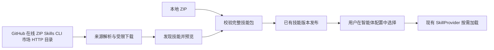



<a id="sage-技能远程导入方案"></a>

# Remote Skill import for Sage

Beyond ZIP upload, Sage can support Git repositories, online ZIPs, marketplaces and team HTTP catalogs, including pasted npx skills add commands. Phase one covers public GitHub, online ZIP and Skills CLI; phase two adds ClawHub and update checks, with team catalogs driven by distribution needs. All sources publish existing Sage Skill versions that users select in Agent configuration.

This design proposal covers Server V2 and Web V2. Source review date: 2026-10-19.

<a id="当前实现范围"></a>

## Current implementation scope

The import dialog now offers online ZIP and Skills CLI alongside local upload. POST /api/skill-import-previews discovers candidates and POST /api/skill-imports publishes selected Skills. Same-name updates require explicit selection; publication compares content digests/current versions and returns per-item results.

Skills CLI currently accepts public GitHub sources. Commands resolve to a fixed-commit repository ZIP; validated Skills are copied project-locally by pinned skills@1.7.2 and published through the existing catalog. Server requires Node.js 22.20+, npx and GitHub/npm access. Online ZIP accepts public HTTPS port 443 only. Downloads revalidate DNS at every redirect, rejecting local/private/reserved addresses. A fake-IP proxy requires normal server-side DNS resolution.

Marketplaces, private repositories, automatic source updates, a separate Git URL entry and new database tables are not implemented. Their descriptions below remain future design.

<a id="开源项目参考"></a>

## Open-source references

| Project | Upstream approach | Applicable design |
| --- | --- | --- |
| Vercel Skills CLI | GitHub/subdirectories, other Git and direct downloads; discovery/update commands | Discover multiple Skills from pasted sources; separate source resolution and destination |
| OpenClaw | ClawHub, Git and local directories, with separate personal ZIP/version management | Install pinned marketplace identities; keep catalog and Session selection separate |
| OpenAI Skills installer | GitHub repository/path/ref, multiple paths, refusing existing destinations | Exact subdirectory/ref and explicit existing-Skill handling |
| OpenCode | Local discovery; V2 development HTTP index.json catalog | Static enterprise distribution without building a marketplace |

Sources: [Vercel Skills CLI](https://github.com/vercel-labs/skills/blob/main/README.md), [OpenClaw Skills CLI](https://docs.openclaw.ai/cli/skills), [OpenAI installer](https://github.com/openai/skills/blob/main/skills/.system/skill-installer/scripts/install-skill-from-github.py), [OpenCode documentation](https://opencode.ai/docs/skills/), [OpenCode V2 development documentation](https://dev.opencode.ai/v2/docs/skills/). The V2 catalog is a design reference, not a guarantee across all released OpenCode versions.

skills.sh helps discover Skills; downloads resolve to concrete repositories and paths. Vercel Skills CLI is an independent project, not an official Claude Code installer. Importing a Skill must not implicitly install plugins, register MCP servers or broaden tool grants.

<a id="sage-当前基础"></a>

## Existing Sage foundations

- Skills.vue already supports ZIP selection, drag/drop and bulk upload through POST /api/skills/upload. POST /api/skills publishes Markdown but has no create-page entry. Remote import reuses package/catalog services.
- SkillCatalogService converts ZIP/directories/Markdown to SkillPackage, publishing existing skills/skill_versions and version directories. Identical content reuses versions; different same-name content publishes a revision for the same user.
- ZIP validation accepts one Skill root and can strip a wrapper directory. Multi-Skill repositories require discovery of individual roots.
- Agents select existing bindings; CatalogSkillProvider and ReadThroughSkillWorkspace load/materialize on demand. Workspace edits take precedence.
- V1 import_skill_by_url provides a ZIP-download entry pattern; V2 publication stays in V2. Its automatic redirects require remote-access safeguards before reuse.
- app/skills/claw-skill-shub/SKILL.md explains ClawHub CLI, but does not establish marketplace support in V2 UI/catalog/version storage.

Code: [UI](../../../app/v2/server/web/src/views/Skills.vue), [routes](../../../app/v2/server/routers/skills.py), [publication](../../../app/v2/server/skills/service.py), [validation](../../../app/v2/server/skills/files.py), [runtime](../../../app/v2/server/skills/runtime.py), [models](../../../app/v2/server/skills/orm.py).

<a id="导入来源与交互"></a>

## Sources and interaction

Keep the Import Skill title and add local-file/online-address choices, with marketplace later. Do not add a page subtitle; put complex rules in field help.

<a id="git-仓库"></a>

### Git repositories

Phase one supports public GitHub HTTPS repositories and Skill directories:

```text
https://github.com/anthropics/skills
https://github.com/anthropics/skills/tree/main/skills/pdf
```

Repositories open candidate selection; directory URLs restrict discovery to that subtree. Advanced inputs separate repository, ref and path to disambiguate slashes in branches. Resolve branches/tags/default branch to an exact commit shared by preview and publication.

Scan a bounded tree for SKILL.md roots, retaining complete relative directory contents. Avoid duplicate nested roots. Display repository licenses as source metadata without rewriting Skill text.

Show name, description, repository path, file count, size and new/identical/conflict/unavailable status. Duplicate names within a batch are conflicts, never list-order overwrites.

GitLab, Gitee and private Git require later dedicated adapters. Phase one rejects arbitrary protocols, SSH addresses and user Git commands.

<a id="在线-zip"></a>

### Online ZIP

Direct HTTPS ZIPs serve object storage, release assets and internal distribution. Single Skills reuse validation; multi-Skill archives use repository-style discovery/selection.

A ZIP is a content snapshot. Preview returns a digest; publication redownloads must match it or require a fresh preview. URL suffixes, ETags and filenames do not establish equality.

A direct SKILL.md URL may later provide a single-file shortcut. Relative dependencies require a complete directory/package to preserve scripts, templates and references.

<a id="skills-cli-命令导入"></a>

### Skills CLI commands

Online import accepts pasted commands such as:

```bash
npx skills add vercel-labs/agent-skills --skill web-design-guidelines
```

npm runs Vercel Skills CLI; arguments after add identify the source. Phase one accepts GitHub shorthand/public repository/directory URLs and --skill/-s selection. Omitted selection opens candidates. The [official README](https://github.com/vercel-labs/skills/blob/main/README.md) documents these options.

The upstream target list has no dedicated Sage destination. A backend adapter can run a pinned CLI in a temporary workspace with isolated HOME, force project --agent universal --copy --yes, then validate complete .agents/skills directories and publish them. Agent binding still uses existing configuration; writing server files alone does not integrate a Skill.

Parse only supported sources/options, then invoke a backend-controlled argument array without shell evaluation. Reject --global, other Agent targets, --all, other subcommands and shell concatenation. --list maps to preview; --yes never bypasses Sage conflict checks.

Reuse source restrictions, exact commits and digests. Phase one downloads a fixed-commit ZIP and passes only validated local Skill contents to CLI. Bound concurrency, duration, output and files; isolate HOME, omit server credentials and disable npm install scripts. Read file paths/metadata from actual files rather than parsing human terminal output as a stable API.

This entry is in phase one. Treating arbitrary npm packages as Skill distribution artifacts is outside scope.

<a id="技能市场"></a>

### Marketplaces

Phase two starts with a ClawHub adapter for search, detail, version selection and import. Resolve owner/slug/version to a complete package and reuse publication.

Resolve skills.sh URLs to repository import when reliable; otherwise retain the repository entry. Equal slugs from different marketplaces are distinct sources.

<a id="团队-http-目录"></a>

### Team HTTP catalogs

Internal distribution can use an OpenCode V2-style HTTP index.json listing Skills/files, hosted statically or in object storage. Sage publishes selected fixed snapshots. Catalog versions are upstream declarations; Sage computes content digests.

Catalog files require same-origin safe relative paths. An arbitrary external-link list must not become an unrestricted downloader.

<a id="后端接入边界"></a>

## Backend boundaries



Add adapters/import service in app/v2/server/skills. Adapters normalize sources, fetch fixed content and discover candidates. Existing publication owns users, validation, digests and versions. Source parsing stays outside sagents/v2 inference; chat does not contact upstream repositories.

Prefer GitHub APIs for commit/path resolution, then bounded content fetch. Limit scans, bytes and files independently, requiring subdirectories for large repositories. Git hooks, submodules, external LFS downloads and dependency installation are excluded.

Add two endpoints using existing authentication, snake_case and ApiResponse:

| Endpoint | Input and result |
| --- | --- |
| `POST /api/skill-import-previews` | Source, optional ref/path → canonical source, commit, candidate paths, digests, validation/conflicts |
| `POST /api/skill-imports` | Fixed source, selected paths, expected digests, per-item conflict policy and expected version_id → success/unchanged/conflict/failure |

Default import rejects same-name replacement. Explicit preview Update existing Skill permits updates with expected version_id concurrency checks. User/name checks and version switching must be transactional, not dependent on preview alone.

Preview creates no business database records. A temporary cache may have expiry, user isolation and quotas; publication can instead refetch fixed content and verify digests. Multiple Server instances must refetch independently rather than depend on process memory tokens. Revalidate all inputs/digests at publication.

Return results per Skill, retaining partial-success ZIP semantics. Publish only after complete package validation; failure preserves the old version. Identical retries return unchanged. Same-name conflicts cannot update another user's Skills.

<a id="版本和生效规则"></a>

## Version activation

Phase one imports fixed snapshots, with new preview for updates and no promise to retain source metadata. Reuse skill_id and increment revisions; identical content creates no version.

Import does not modify Agent bindings. Later Runs resolve updated versions through the existing catalog while admitted Runs keep frozen versions. Workspace edits still win and must not be overwritten silently; display that state accurately. Verify cache refresh and existing-session activation timing during implementation.

If phase two adds update checks, extend existing version records with business source fields: type, canonical URL, path, requested ref, resolved commit or marketplace version. Store credential references only, never secrets in URLs. No audit table, import-history database or separate Skill database is needed.

After manual edits, updates show diffs and require explicit overwrite. Upstream rename does not rename local Skills. Import-time renaming is deferred to avoid breaking internal references. Future rollback can reuse existing versions/artifacts but needs its own authorized operation.

<a id="远程导入约束"></a>

## Remote import constraints

- Accept controlled HTTPS targets and validate DNS plus actual connection addresses, rejecting local/private/metadata endpoints. Revalidate bounded redirects and do not forward credentials across hosts. Private Git later requires explicit administrator connections.
- Stream bounds for compressed/expanded bytes, files, per-file size, duration and scan depth. Current single-Skill limits are 32 MiB compressed, 64 MiB expanded and 2000 files; repository discovery also needs aggregate limits before reads/extraction.
- Reject traversal, symlinks, special files and duplicate paths. Validate in staging, preserve scripts/executable bits, and do not execute scripts or install dependencies.
- Complete packages include SKILL.md, scripts, references and assets as defined by the [Agent Skills specification](https://agentskills.io/specification). Acceptance does not grant tools, MCP, network or runtime dependencies.
- Preserve imported metadata without mapping allowed-tools, platform fields or textual permission claims into Sage grants. Report format/compatibility issues per item rather than rewriting naming rules globally.

<a id="实施顺序与验收"></a>

## Implementation and acceptance

1. Add GitHub/online ZIP/Skills CLI fetching, discovery, previews and publication, reusing catalog/version/binding services.
2. Add online address, candidate selection and explicit same-name update choices with per-item results/retry.
3. Verify single/multi-Skill repositories, CLI parsing/isolation, scripts/binaries, identical retries, conflicts/concurrent updates, upstream changes, downloads, authorization and malicious paths. Check existing bindings, frozen Runs and workspace edit precedence.
4. Phase two adds ClawHub, source metadata and explicit update checks; team/private sources follow actual distribution needs.

Phase one needs no full marketplace page, automatic synchronization or new database tables. Its purpose is reliable source paste, Skill selection and import.
