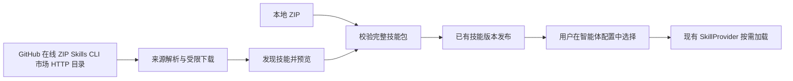



# Sage 技能远程导入方案

Sage 可以在现有 ZIP 上传之外，增加 Git 仓库、在线 ZIP、技能市场和团队 HTTP 目录四种来源，并支持粘贴 `npx skills add ...` 命令导入。建议第一期实现公开 GitHub 仓库、在线 ZIP 和 Skills CLI 导入入口，第二期接入 ClawHub 和更新检查，团队目录按内部共享需求增加。所有来源最终都发布为 Sage 已有的技能版本，再由用户在智能体配置中选择。

本文是设计提案，范围为 Server V2 和 Web V2。资料核对日期为 2026 年 10 月 19 日。

## 当前实现范围

Web 的导入弹框已增加“在线 ZIP”和“Skills CLI”，沿用本地 ZIP 上传。远程来源通过 `POST /api/skill-import-previews` 预览，用户选中技能后调用 `POST /api/skill-imports`。同名更新需明确勾选；发布时比较内容摘要和现有版本，逐项返回结果。

Skills CLI 当前接受公开 GitHub 来源，解析命令后先获取固定 commit 的仓库 ZIP，将校验后的技能包交给固定版本 `skills@1.7.2` 做项目级复制安装，再发布到现有目录。服务器需要 Node.js 22.20 以上、npx，以及 GitHub 和 npm registry 网络访问。在线 ZIP 仅接受公开 HTTPS 的 443 端口地址。下载会重新校验每次重定向的 DNS，拒绝本机、私网和保留地址；本机代理若使用 fake IP，需要在服务器配置正常的 DNS 解析。

当前没有接入市场、私有仓库、来源自动更新、单独 Git 地址入口或新数据库表。下文涉及这些能力的部分仍是后续设计。

## 开源项目参考

| 项目 | 官方支持的做法 | Sage 可以借鉴的部分 |
| --- | --- | --- |
| Vercel Skills CLI | GitHub 仓库和子目录、其他 Git 来源、直接下载地址；提供发现和更新命令 | 粘贴来源后发现多个技能，用户选择需要的项；将来源解析与安装目标分开 |
| OpenClaw | 技能安装支持 ClawHub、Git 和本地目录；个人技能库另有 ZIP 导入与修订管理 | 市场通过技能标识和版本安装；技能库与会话选择分开 |
| OpenAI Skills 的安装脚本 | 根据 GitHub 仓库、路径和 ref 安装，支持多个路径，目标存在时拒绝覆盖 | 精确导入子目录，固定 ref，显式处理已有技能 |
| OpenCode | 常规文档描述本地目录发现；V2 开发文档还定义 HTTP catalog，以 index.json 列出名称、版本和文件 | 企业可以通过静态目录分发技能，不必先开发完整市场 |

来源：[Vercel Skills CLI](https://github.com/vercel-labs/skills/blob/main/README.md)、[OpenClaw Skills CLI](https://docs.openclaw.ai/cli/skills)、[OpenAI 安装脚本](https://github.com/openai/skills/blob/main/skills/.system/skill-installer/scripts/install-skill-from-github.py)、[OpenCode 常规文档](https://opencode.ai/docs/skills/)、[OpenCode V2 开发文档](https://dev.opencode.ai/v2/docs/skills/)。OpenCode V2 的目录协议作为设计参考，不视为所有现行版本的统一行为。

skills.sh 可用于发现技能，实际获取应解析到具体仓库和路径。Vercel Skills CLI 是独立开源项目，不是 Claude Code 官方安装器。插件和 MCP 服务可以与技能一起分发，但导入一个技能不应顺带安装插件、注册 MCP 或扩大工具授权。

## Sage 当前基础

- 原有 Web 的 `Skills.vue` 提供 ZIP 选择、拖入和批量上传；后端入口是 `POST /api/skills/upload`。后端另有 `POST /api/skills`，可直接发布 Markdown 内容，但页面没有对应的新建入口。新增远程入口复用这些已有包处理与目录发布能力。
- `SkillCatalogService` 已支持 ZIP、目录和 Markdown 转为 `SkillPackage`，统一发布到现有 `skills`、`skill_versions`，文件放在版本目录下。相同内容复用已有版本；同一用户下同名但不同内容会发布新修订。
- 当前 ZIP 校验器接收一个技能包，在全部文件属于同一个技能根目录时允许去除包装目录；整个多技能仓库的压缩包不能直接当成一个技能导入，需要先发现各个技能根目录。
- Agent 通过已有绑定选择技能，运行时使用 `CatalogSkillProvider` 按需读取技能包，由 SDK 的 `SandboxSkillWorkspace` 物化到工作区；已有文件内容不同时拒绝覆盖，版本更新通过 Agent guidance 同步接口处理。
- V1 的 `import_skill_by_url` 已实现下载 ZIP 后导入。V2 可参考入口体验，实际发布继续走 V2；V1 的自动重定向下载逻辑需要补齐远程访问限制后才能用于新入口。
- `app/skills/claw-skill-shub/SKILL.md` 提供调用 ClawHub CLI 的指引。这不代表 V2 的技能页面、目录发布和版本记录已经支持 ClawHub。

代码位置：[页面](../../../app/v2/server/web/src/views/Skills.vue)、[路由](../../../app/v2/server/routers/skills.py)、[发布服务](../../../app/v2/server/skills/service.py)、[包校验](../../../app/v2/server/skills/files.py)、[运行时](../../../app/v2/server/skills/runtime.py)、[现有模型](../../../app/v2/server/skills/orm.py)。

## 导入来源与交互

导入弹框保留标题“导入技能”，增加“本地文件”“在线地址”两个入口。接入市场后再增加“技能市场”。不增加页面副标题；复杂规则放在具体字段帮助中。

### Git 仓库

第一期支持公开 GitHub HTTPS 仓库和技能目录地址，例如：

```text
https://github.com/anthropics/skills
https://github.com/anthropics/skills/tree/main/skills/pdf
```

仓库地址进入技能选择列表；目录地址只发现该目录内的技能。高级输入分别提供仓库、ref 和子目录，避免带斜线的分支名与目录路径产生歧义。分支、tag 和默认分支均先解析成准确 commit，预览与发布使用同一个 commit。

发现时扫描受限目录树中的 `SKILL.md`，每个包含它的目录构成一个候选技能；选定目录的相对文件结构整体保留。遇到嵌套技能根目录不重复打包。仓库级许可证可以展示在来源信息中，但不能悄悄改写技能正文。

列表展示名称、描述、仓库内路径、文件数、体积，以及“新增”“相同内容”“同名冲突”“不可导入”状态。同一批候选若声明相同名称，也必须显示冲突，不能按列表顺序覆盖。

GitLab、Gitee 和私有 Git 仓库后续增加独立来源适配器。首期不接受任意 Git 协议、SSH 地址或用户输入的 Git 命令。

### 在线 ZIP

支持直接下载 ZIP 的 HTTPS 地址，适合对象存储、Release 附件和内部制品分发。下载完成后，单技能包复用现有校验；多技能 ZIP 复用仓库发现和选择流程。

远程 ZIP 是内容快照。预览返回包摘要；正式导入若重新下载，必须检查摘要一致，发生变化时要求重新预览。不能依赖 URL 后缀、ETag 或文件名证明内容相同。

单独的 `SKILL.md` 地址可作为后续便捷入口，但只能表示单文件技能。含相对资源依赖时应引导用户使用目录或完整包，避免导入后缺失脚本、模板和参考资料。

### Skills CLI 命令导入

在线导入入口允许粘贴技能网站提供的命令，例如：

```bash
npx skills add vercel-labs/agent-skills --skill web-design-guidelines
```

这里通过 npm 启动的是 Vercel Skills CLI，技能来源由 add 后的参数决定。第一期支持 GitHub 简写、公开仓库或目录地址，以及 `--skill` / `-s` 选择；没有指定技能时展示候选列表。[官方 README](https://github.com/vercel-labs/skills/blob/main/README.md)说明了这些参数和来源格式。

当前官方支持列表没有 Sage 专用目标。后端可增加 CLI 适配器：在独立临时工作目录和隔离 HOME 中运行固定版本的 Skills CLI，强制项目级 `--agent universal --copy --yes`，从 `.agents/skills` 读取得到的完整技能目录，经过 Sage 校验后发布到现有目录。用户仍在已有智能体配置中选择技能；不能只把文件写进服务端目录就视为已经接入 Sage。

输入命令只用于解析允许的来源和选项，再通过参数数组启动后端控制的 CLI，不直接交给 shell。`--global`、其他 Agent 目标、`--all`、其他子命令和 shell 拼接不进入执行参数；超出支持范围时明确提示。`--list` 映射为预览，`--yes` 不跳过 Sage 的冲突处理。

CLI 适配器复用统一的来源限制、准确 commit 和包摘要约束。首期获取准确 commit 的仓库 ZIP，只将校验后的技能文件作为本地来源交给 CLI；其他来源逐项开放。适配器限制并发导入、运行时间、输出和文件总量，隔离 HOME，不继承服务端凭据，并禁用 npm 安装脚本。发现后的文件路径与元数据从实际文件读取，不把人类可读终端输出当成稳定 JSON API。

这一入口纳入第一期。直接把 npm registry 中的包当作技能分发制品不在本次需求范围。

### 技能市场

第二期先接一个 ClawHub 适配器，实现搜索、详情、选择版本和导入。将市场的 owner、slug、版本解析成完整技能文件包后，走相同发布链路。

skills.sh 地址可解析成仓库导入；无法可靠解析时保留原仓库入口。不要将不同市场的同名 slug 视为同一来源。

### 团队 HTTP 目录

有内部集中分发需求时，可采用类似 OpenCode V2 的 HTTP catalog：一个 index.json 声明技能和文件，静态站点或对象存储即可托管。Sage 获取选中技能并发布固定快照。目录版本只作为上游声明，完整文件摘要仍由 Sage 计算。

目录中的文件限定同源和安全相对路径；不要把任意外链清单变成无限制的服务端下载器。

## 后端接入边界



在 `app/v2/server/skills` 增加导入服务与来源适配器。适配器负责规范化地址、获取固定内容和发现候选；现有发布服务负责用户归属、包校验、摘要和版本。来源解析不进入 `sagents/v2` Agent 循环，聊天时不连接上游仓库。

GitHub 优先通过仓库 API 解析 commit 和目录信息，再受限获取内容。对仓库扫描、下载字节数和文件数量分别设限；大型仓库要求指定子目录。Git hook、子模块、LFS 外部下载和依赖安装不属于导入过程。

建议增加两个接口，沿用现有认证、snake_case 和 `ApiResponse`：

| 接口 | 输入与结果 |
| --- | --- |
| `POST /api/skill-import-previews` | 输入来源地址、可选 ref 和目录；返回规范化来源、固定 commit、候选路径、包摘要、校验结果及已有版本冲突 |
| `POST /api/skill-imports` | 输入固定来源、选中路径、预期包摘要、每项冲突策略及预期当前 version_id；返回每项成功、未变化、冲突或失败 |

普通导入默认拒绝同名覆盖；用户在预览中明确选“更新已有技能”才允许更新，并以预期 version_id 做并发检查。对同一用户、同名技能的检查与版本切换必须在发布事务中保证，不能只依赖预览结果。

预览不创建业务数据库记录。可使用有过期时间、用户隔离和配额限制的临时文件缓存；正式导入也可重新获取固定来源并核对摘要。多个 Server 实例必须能够重新获取，不能依赖单进程内存令牌。所有输入和摘要均在正式导入时重新校验。

批量操作按技能返回结果，延续现有 ZIP 部分成功语义；单个技能完整校验成功后再发布，失败不切换旧版本。重试内容相同的技能返回未变化。同名冲突不允许跨用户更新。

## 版本和生效规则

第一期只提供固定快照导入，更新时重新提交来源并预览，不承诺自动记住来源。新版本沿用已有 skill_id 和递增修订；相同内容不产生新版本。

导入不自动修改任何 Agent 绑定。更新后，已绑定该技能的 Agent 在后续运行中按现有目录解析机制取得新版本；已开始的 Run 保持其冻结版本。已有工作区编辑版本会优先使用，新导入不能静默覆盖，界面应准确提示这一状态。实施时需核实缓存刷新和既有会话的实际生效时点。

第二期若提供“检查更新”，在现有技能版本模型中增加必要的来源信息，如来源类型、规范化地址、目录、请求 ref、resolved commit 或市场版本。它们服务于重新获取和比较更新，是业务字段。凭据仅存安全引用，不写入来源 URL。无需另建审计表、导入历史库或独立技能数据库。

手工编辑远程技能后，更新必须显示差异并要求明确覆盖。上游重命名不自动改名；冲突暂不提供导入时重写技能名称，以免破坏内部引用。后续回退可复用已有版本记录和制品，但需要另行提供受权限保护的回退操作。

## 远程导入约束

- 下载仅接受受控 HTTPS 目标，检查 DNS 解析结果与实际连接地址，拒绝本机、私网和云元数据地址；每次重定向重新校验，限制次数，认证信息不跨主机转发。内网 Git 服务后续通过管理员配置的明确连接接入。
- 流式限制压缩包大小、展开大小、文件数、单文件大小、超时和扫描深度。现有单技能限制为压缩 ZIP 32 MiB、展开 64 MiB、最多 2000 个文件；仓库整体发现还需独立总量限制，在读取文件和解压前检查。
- 拒绝路径穿越、符号链接、特殊文件及重复路径；使用暂存目录完成校验后发布。保留脚本文件与必要执行位，不执行脚本或安装依赖。
- 标准目录携带 `SKILL.md`、scripts、references、assets 等文件。[Agent Skills 规范](https://agentskills.io/specification)定义了这一结构。导入成功只说明包已接纳，外部工具、MCP、网络权限和运行依赖仍按当前 Agent 配置决定。
- 保留外来元数据，但不把 `allowed-tools`、平台专用字段或文本中的授权要求自动映射成 Sage 权限。标准格式校验与平台兼容性问题应逐项显示；不因增加远程入口而全局改写已有技能命名规则。

## 实施顺序与验收

1. 增加 GitHub、在线 ZIP 和 Skills CLI 获取、发现、预览，以及正式导入接口，复用现有发布、目录和绑定。
2. 导入弹框增加在线地址入口、候选选择和同名更新选择，保留逐项结果及失败重试。
3. 验证公开仓库的单技能和多技能、Skills CLI 命令解析及临时目录隔离、含脚本和二进制资源的完整包、相同内容重试、同名冲突及并发更新、上游内容变化、下载失败、越权和恶意路径。验证已有 Agent 绑定、Run 固定版本和工作区编辑优先级。
4. 第二期接入 ClawHub、来源记录和显式检查更新；团队目录与私有 Git 按实际分发需要接入。

首期不需要完整市场页面、上游自动同步任务或新增数据库表。实现重点是让用户直接粘贴来源、选中技能并完成可靠导入。
